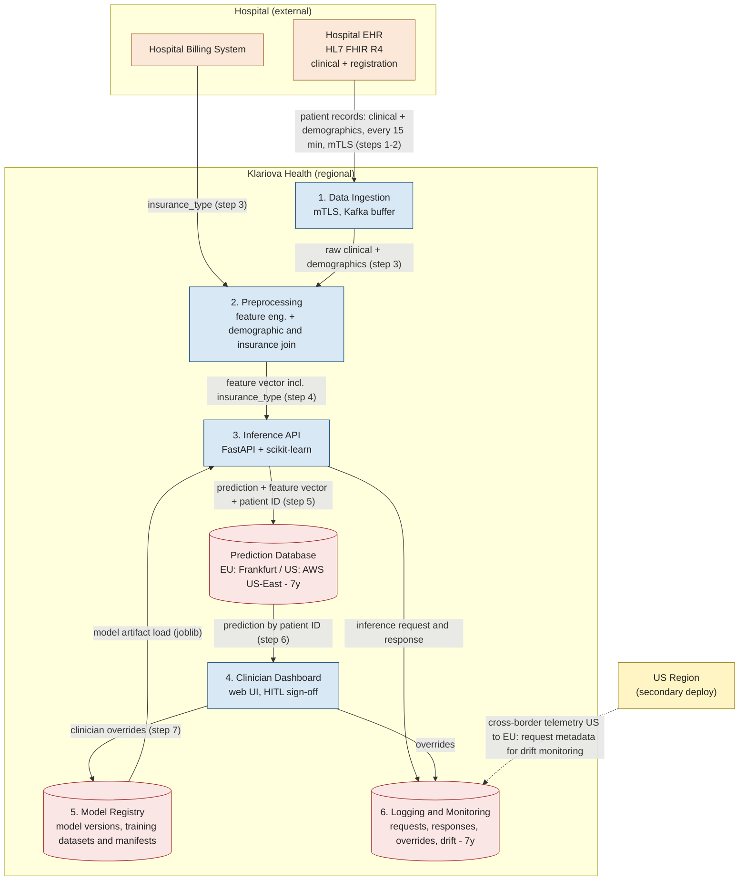

# HealthGuard — Data Flow Diagram (revised)

A corrected version of artifact A6 (`data_flow_diagram.png`), redrawn to match
the component descriptions (§5) and data flow narrative (§6) in
`case_study_brief.md`. Edge labels cite the narrative step they come from.

**Legend:** orange = external system · blue = processing component ·
red = stores personal data · yellow = secondary region · dashed = cross-border flow

## Changes from A6

| A6 edge / element | Revised | Basis in brief |
|---|---|---|
| Dashboard → Registry labelled "log access" | Labelled "clinician overrides" | Step 7: overrides are logged back to the Model Registry for retraining |
| Preprocessing → Registry "model load" | Registry → Inference API "model artifact load" | Component 3 loads the trained joblib artifact; Component 5 stores artifacts |
| Inference API → Dashboard "score" | Inference API → Prediction DB → Dashboard | Step 5 stores predictions; step 6 says the Dashboard pulls by patient ID |
| Logging → Prediction DB "predictions+IDs" | Inference API → Prediction DB | Step 5: inference output is stored in the prediction database |
| Registry → Logging "events" | Removed; Inference API → Logging and Dashboard → Logging added | Component 6 captures inference requests, responses and clinician overrides |
| Model Registry and Logging shown as purple "supporting" storage | Shown red (personal data) | Registry holds training datasets + overrides; logs hold full requests and overrides (patient data) |
| "raw + demo" | "raw clinical + demographics" | Component 2 / step 3: demographics joined with clinical data |
| No billing source | Hospital Billing System → Preprocessing "insurance_type" | Step 3: `insurance_type` is sourced from the hospital's billing system and may be stale |

**Note on the billing flow:** the brief doesn't say how billing data reaches
Klariova. Only the EHR feed is described as FHIR over mTLS, so the transport,
authentication and data-processing agreement coverage for this flow are open
questions worth flagging in Task 2.
